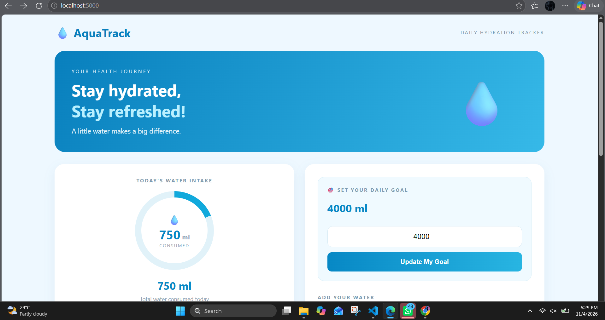
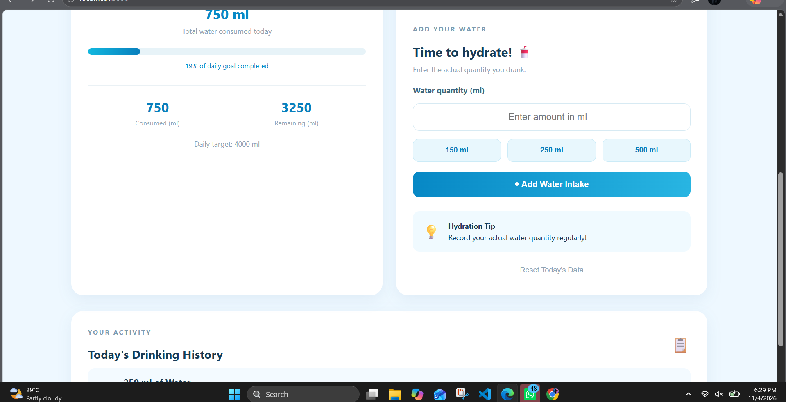
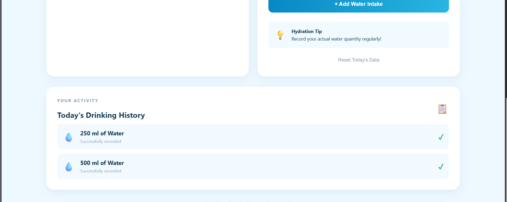

# dos_task
## AIM
To develop a water intake tracking website using HTML, CSS, Python Flask, and SQLite to record daily water consumption and monitor hydration goals.

## ALGORITHM
STEP 1: Create the project folder and required HTML, CSS, and Python files.

STEP 2: Design an attractive website using HTML and CSS.

STEP 3: Connect the website with Python Flask for backend processing.

STEP 4: Create an SQLite database to store water intake and daily goals.

STEP 5: Allow users to set their daily water goal and enter custom water quantities.

STEP 6: Calculate and display total water intake, remaining quantity, and progress.

STEP 7: Display daily water history and provide an option to reset the records.

## PROGRAM
index.html
```

<!DOCTYPE html>
<html>

<head>

    <title>AquaTrack - Hydration Tracker</title>

    <meta name="viewport" content="width=device-width, initial-scale=1.0">

    <link rel="stylesheet"
    href="{{ url_for('static', filename='style.css') }}">

</head>

<body>

<div class="container">

    <!-- Navigation -->

    <nav>

        <div class="logo">💧 AquaTrack</div>

        <div class="nav-text">DAILY HYDRATION TRACKER</div>

    </nav>


    <!-- Welcome Banner -->

    <section class="welcome">

        <div>

            <p class="small-title">YOUR HEALTH JOURNEY</p>

            <h1>
                Stay hydrated,<br>
                <span>Stay refreshed!</span>
            </h1>

            <p class="subtitle">
                A little water makes a big difference.
            </p>

        </div>

        <div class="big-drop">💧</div>

    </section>


    <!-- Main Dashboard -->

    <section class="dashboard">


        <!-- LEFT CARD: WATER PROGRESS -->

        <div class="main-card">

            <p class="card-label">TODAY'S WATER INTAKE</p>


            <!-- Circular Progress -->

            <div class="circle" data-progress="{{ progress }}">

                <div class="circle-inner">

                    <span class="drop">💧</span>

                    <h1>{{ total }}<small> ml</small></h1>

                    <p>CONSUMED</p>

                </div>

            </div>


            <h2>{{ total }} ml</h2>

            <p class="muted">
                Total water consumed today
            </p>


            <!-- Progress Bar -->

            <div class="progress">

                <div class="progress-fill"
                     data-progress="{{ progress }}">
                </div>

            </div>


            <p class="percentage">
                {{ "%.0f"|format(progress) }}% of daily goal completed
            </p>


            <!-- Statistics -->

            <div class="stats">

                <div>

                    <h2>{{ total }}</h2>

                    <p>Consumed (ml)</p>

                </div>


                <div>

                    <h2>{{ remaining }}</h2>

                    <p>Remaining (ml)</p>

                </div>

            </div>


            <p class="daily-target">
                Daily target: {{ goal }} ml
            </p>

        </div>


        <!-- RIGHT CARD: GOAL AND WATER ENTRY -->

        <div class="action-card">


            <!-- Custom Daily Goal -->

            <div class="goal-box">

                <p class="card-label">🎯 SET YOUR DAILY GOAL</p>

                <h2>{{ goal }} ml</h2>

                <form action="/set_goal" method="POST">

                    <input
                        type="number"
                        name="goal"
                        min="100"
                        max="10000"
                        value="{{ goal }}"
                        placeholder="Enter daily goal in ml"
                        required
                    >

                    <button type="submit" class="goal-btn">
                        Update My Goal
                    </button>

                </form>

            </div>


            <!-- Add Water -->

            <div class="water-entry">

                <p class="card-label">ADD YOUR WATER</p>

                <h2>Time to hydrate! 🥤</h2>

                <p class="muted">
                    Enter the actual quantity you drank.
                </p>


                <form action="/add" method="POST">

                    <label for="amount">
                        Water quantity (ml)
                    </label>


                    <input
                        type="number"
                        id="amount"
                        name="amount"
                        min="1"
                        max="5000"
                        placeholder="Enter amount in ml"
                        required
                    >


                    <!-- Quick Add Buttons -->

                    <div class="quick-buttons">

                        <button type="button"
                        onclick="setAmount(150)">
                            150 ml
                        </button>

                        <button type="button"
                        onclick="setAmount(250)">
                            250 ml
                        </button>

                        <button type="button"
                        onclick="setAmount(500)">
                            500 ml
                        </button>

                    </div>


                    <button type="submit" class="add-btn">
                        + Add Water Intake
                    </button>

                </form>


                <!-- Hydration Tip -->

                <div class="tip">

                    <span>💡</span>

                    <p>
                        <b>Hydration Tip</b><br>
                        Record your actual water quantity regularly!
                    </p>

                </div>


                <!-- Reset Button -->

                <form action="/reset" method="POST">

                    <button type="submit" class="reset-btn">
                        Reset Today's Data
                    </button>

                </form>

            </div>

        </div>

    </section>


    <!-- DRINKING HISTORY -->

    <section class="history">

        <div class="history-heading">

            <div>

                <p class="card-label">YOUR ACTIVITY</p>

                <h2>Today's Drinking History</h2>

            </div>

            <span class="history-icon">📋</span>

        </div>


        

            

                <div class="record">

                    <span class="record-icon">💧</span>

                    <div>

                        <b>{{ record.amount_ml }} ml of Water</b>

                        <p>Successfully recorded</p>

                    </div>

                    <span class="check">✓</span>

                </div>

            

        

            <div class="empty">

                <span>💦</span>

                <p>No records yet. Start drinking water!</p>

            </div>

        

    </section>


    <!-- FOOTER -->

    <footer>

        Made with 💙 for a healthier you | AquaTrack © 2026

    </footer>

</div>


<!-- JavaScript -->

<script>

    function setAmount(value) {

        document.getElementById("amount").value = value;

    }


    let circle = document.querySelector(".circle");

    let bar = document.querySelector(".progress-fill");


    circle.style.setProperty(
        "--progress",
        circle.dataset.progress + "%"
    );


    bar.style.width = bar.dataset.progress + "%";

</script>


</body>

</html>
```
style.css
```

* {
    margin: 0;
    padding: 0;
    box-sizing: border-box;
}

body {
    font-family: 'Segoe UI', Arial, sans-serif;
    background: #eef8ff;
    color: #183b56;
}

.container {
    max-width: 1150px;
    width: 92%;
    margin: auto;
}

/* NAVIGATION */

nav {
    display: flex;
    justify-content: space-between;
    align-items: center;
    padding: 25px 0;
}

.logo {
    font-size: 27px;
    font-weight: bold;
    color: #087fbd;
}

.nav-text {
    font-size: 12px;
    letter-spacing: 2px;
    color: #7291a7;
}


/* WELCOME BANNER */

.welcome {
    background: linear-gradient(120deg, #087fbd, #36b9e8);
    border-radius: 25px;
    padding: 40px;
    color: white;

    display: flex;
    justify-content: space-between;
    align-items: center;

    margin-bottom: 28px;
}

.small-title {
    font-size: 12px;
    letter-spacing: 3px;
    margin-bottom: 12px;
    opacity: 0.85;
}

.welcome h1 {
    font-size: 38px;
    line-height: 1.3;
}

.welcome h1 span {
    color: #b9f0ff;
}

.subtitle {
    margin-top: 12px;
    opacity: 0.9;
}

.big-drop {
    font-size: 105px;
    margin-right: 35px;
}


/* MAIN DASHBOARD ALIGNMENT */

.dashboard {
    display: grid;
    grid-template-columns: 1fr 1fr;
    gap: 25px;
    align-items: stretch;
}


/* LEFT AND RIGHT CARDS */

.main-card,
.action-card,
.history {
    background: white;
    border-radius: 22px;
    padding: 30px;

    box-shadow: 0 8px 25px rgba(33, 107, 150, 0.08);

    min-width: 0;
}


/* LEFT CARD */

.main-card {
    text-align: center;
}

.card-label {
    font-size: 12px;
    font-weight: bold;
    color: #7d9bb0;
    letter-spacing: 2px;
    margin-bottom: 18px;
}


/* CIRCULAR PROGRESS */

.circle {
    width: 185px;
    height: 185px;
    border-radius: 50%;
    margin: 15px auto 20px;

    background: conic-gradient(
        #11a9dc 0%,
        #11a9dc var(--progress),
        #e1f2f9 var(--progress),
        #e1f2f9 100%
    );

    display: flex;
    align-items: center;
    justify-content: center;
}

.circle-inner {
    width: 155px;
    height: 155px;
    border-radius: 50%;
    background: white;

    display: flex;
    flex-direction: column;
    justify-content: center;
    align-items: center;
}

.drop {
    font-size: 23px;
}

.circle-inner h1 {
    font-size: 29px;
    color: #0788c5;
}

.circle-inner h1 small {
    font-size: 15px;
    color: #91aabd;
}

.circle-inner p {
    font-size: 10px;
    letter-spacing: 2px;
    color: #8ca5b7;
}

.main-card > h2 {
    color: #0788c5;
    font-size: 25px;
    margin-top: 5px;
}

.muted {
    color: #8ba1b1;
    font-size: 13px;
    margin-top: 7px;
}


/* PROGRESS BAR */

.progress {
    height: 12px;
    background: #e7f3f8;
    border-radius: 20px;
    margin-top: 23px;
    overflow: hidden;
}

.progress-fill {
    height: 100%;
    background: linear-gradient(90deg, #12b8df, #087fbd);
    border-radius: 20px;
    transition: width 0.4s;
}

.percentage {
    color: #0788c5;
    font-size: 12px;
    margin-top: 12px;
}


/* STATISTICS */

.stats {
    display: flex;
    justify-content: space-around;

    margin-top: 28px;
    padding-top: 22px;

    border-top: 1px solid #eaf1f5;
}

.stats h2 {
    color: #087fbd;
    font-size: 24px;
}

.stats p {
    color: #91a6b5;
    font-size: 12px;
    margin-top: 5px;
}

.daily-target {
    color: #8ba1b1;
    font-size: 13px;
    margin-top: 22px;
}


/* RIGHT CARD ALIGNMENT */

.action-card {
    display: flex;
    flex-direction: column;
    justify-content: center;
    height: 100%;
}


/* GOAL BOX */

.goal-box {
    background: #f0faff;
    padding: 22px;
    border-radius: 15px;
    margin-bottom: 30px;
    border: 1px solid #d5edf8;
}

.goal-box h2 {
    color: #0788c5;
    margin-bottom: 12px;
    font-size: 25px;
}


/* INPUT FIELDS */

.action-card label {
    display: block;
    margin-top: 20px;
    font-size: 14px;
    font-weight: bold;
    color: #41677e;
}

input {
    width: 100%;
    padding: 14px;
    margin-top: 15px;

    border: 1px solid #d7eaf3;
    border-radius: 12px;

    font-size: 17px;
    text-align: center;
    outline: none;
}

input:focus {
    border-color: #0788c5;
}


/* GOAL BUTTON */

.goal-btn {
    width: 100%;
    padding: 14px;
    margin-top: 12px;

    border: none;
    border-radius: 10px;

    background: linear-gradient(90deg, #0788c5, #28b5e2);
    color: white;

    font-weight: bold;
    font-size: 15px;
    cursor: pointer;
}

.goal-btn:hover {
    opacity: 0.85;
}


/* WATER ENTRY */

.water-entry h2 {
    font-size: 23px;
    margin-bottom: 8px;
}


/* QUICK ADD BUTTONS */

.quick-buttons {
    display: flex;
    gap: 12px;
    margin-top: 15px;
}

.quick-buttons button {
    flex: 1;
    padding: 12px;

    background: #e8f7fd;
    border: 1px solid #ccebf7;
    color: #087fbd;

    border-radius: 10px;
    font-weight: bold;
    cursor: pointer;

    transition: 0.3s;
}

.quick-buttons button:hover {
    background: #cceefb;
}


/* ADD WATER BUTTON */

.add-btn {
    width: 100%;
    padding: 15px;
    margin-top: 18px;

    border: none;
    background: linear-gradient(90deg, #0788c5, #28b5e2);
    color: white;

    font-size: 15px;
    font-weight: bold;

    border-radius: 12px;
    cursor: pointer;
}

.add-btn:hover {
    opacity: 0.85;
}


/* HYDRATION TIP */

.tip {
    display: flex;
    align-items: center;
    gap: 12px;

    padding: 15px;
    background: #f0faff;

    border-radius: 12px;
    margin-top: 25px;

    font-size: 13px;
    line-height: 1.6;
}

.tip span {
    font-size: 27px;
}


/* RESET BUTTON */

.reset-btn {
    border: none;
    background: transparent;
    color: #8da4b4;

    cursor: pointer;
    margin-top: 18px;
    width: 100%;
    padding: 8px;
}

.reset-btn:hover {
    color: #e05b5b;
}


/* DRINKING HISTORY */

.history {
    margin-top: 28px;
    width: 100%;
}

.history-heading {
    display: flex;
    justify-content: space-between;
    align-items: center;
}

.history-heading h2 {
    font-size: 21px;
}

.history-icon {
    font-size: 27px;
}

.record {
    display: flex;
    align-items: center;
    gap: 15px;

    background: #f3faff;
    padding: 15px;
    margin-top: 12px;

    border-radius: 12px;
}

.record-icon {
    font-size: 25px;
}

.record p {
    font-size: 12px;
    color: #91a6b5;
    margin-top: 4px;
}

.check {
    margin-left: auto;
    color: #15a77b;
    font-size: 20px;
    font-weight: bold;
}

.empty {
    text-align: center;
    padding: 25px;
    color: #8ba6b7;
}

.empty span {
    font-size: 30px;
}

.empty p {
    margin-top: 10px;
}


/* FOOTER */

footer {
    text-align: center;
    padding: 30px 0;
    color: #8ca5b7;
    font-size: 13px;
}


/* MOBILE RESPONSIVE */

@media (max-width: 700px) {

    .dashboard {
        grid-template-columns: 1fr;
    }

    .welcome {
        padding: 25px;
    }

    .welcome h1 {
        font-size: 27px;
    }

    .big-drop {
        font-size: 65px;
        margin-right: 0;
    }

    .nav-text {
        font-size: 9px;
    }

    .main-card,
    .action-card,
    .history {
        padding: 22px;
    }

}
```

## OUTPUT




## RESULT
Thus, the AquaTrack website was developed successfully to track daily water consumption with customizable goals and database storage.